Agents write most of my code now. I decide what gets built and how the pieces fit, then I read every diff before it ships.

**Read the case studies:** [FetchJobs](https://shubhambhatt.dev/projects/fetchjobs) · [ParkPulse](https://shubhambhatt.dev/projects/parkpulse) · [RAG Microservice](https://shubhambhatt.dev/projects/rag)

[shubhambhatt.dev](https://shubhambhatt.dev) · [LinkedIn](https://www.linkedin.com/in/shubhambhattog/) &nbsp; 
